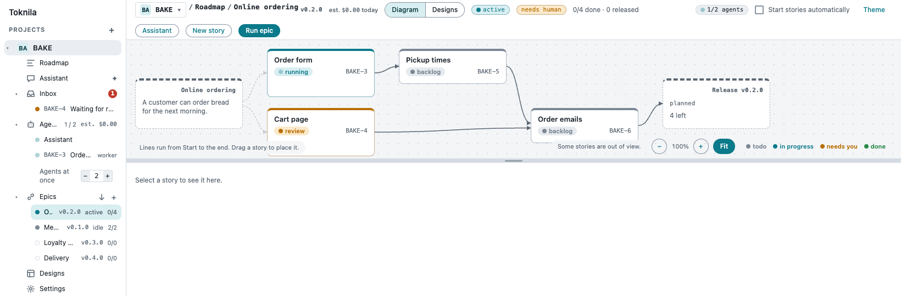
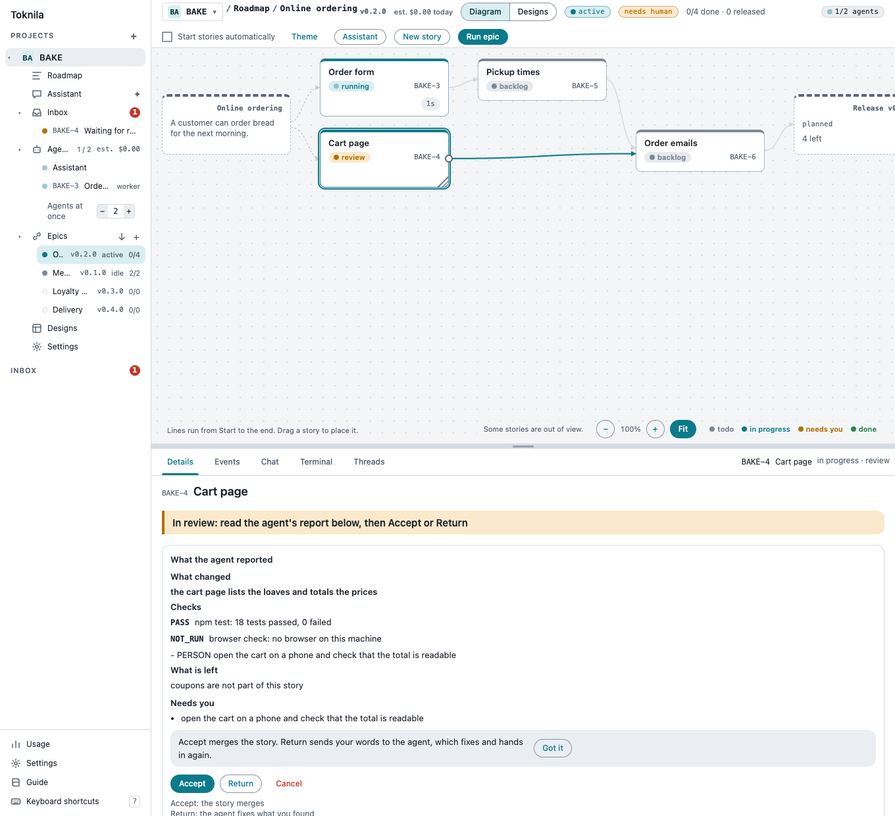
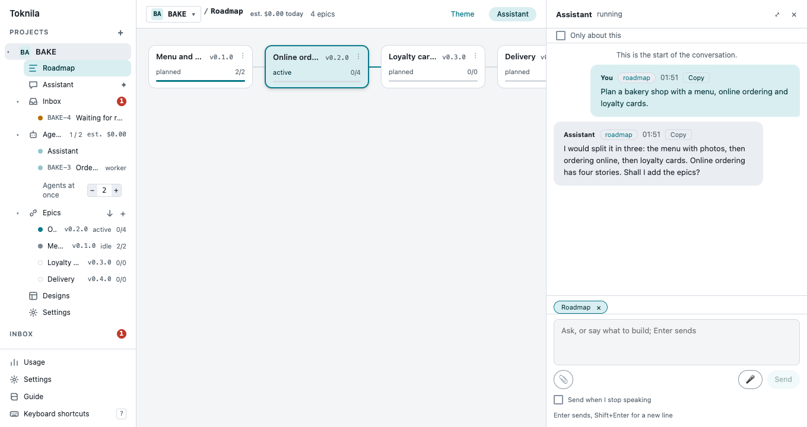
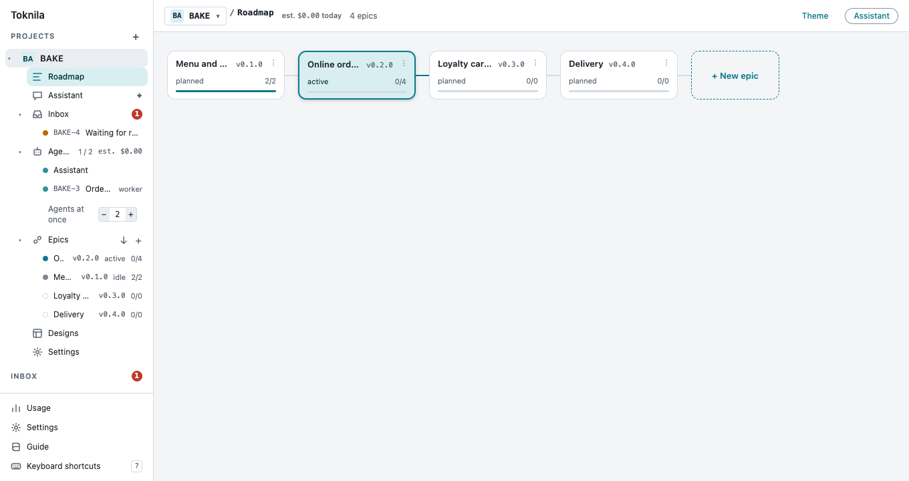

# Toknila

Toknila is an app that runs CLI coding agents on your own computer. You plan a project with the
assistant as epics of stories. Each story runs in its own git worktree with its own agent. A
checker and a reviewer agent look at each hand-in, you accept it, and a release is cut. Your code
and your agent subscription stay on your computer.

It is for a developer or a product person who already uses a CLI coding agent and wants several
stories to move at once, each reviewed before it lands.



## What you need

- A Mac with macOS 10.15 or later, Apple silicon or Intel.
- `git`.
- Claude Code installed and signed in. Toknila starts it for you; nothing else is needed.
- The GitHub command line (`gh`) only if you want accepted work sent as pull requests.

## Install and first run

The steps and the words are those of the Guide inside the app (Guide, at the foot of the sidebar).

1. Download the `.dmg` from the [Releases page](https://github.com/jh0per/Toknila/releases):
   `aarch64` for Apple silicon, `x86_64` for Intel. Open it and drag Toknila onto Applications.
   Open the app; it starts its own daemon and shows its window.
2. **Add a project.** Choose the folder that holds your project, a git repository. If the folder is
   missing or is not a repository yet, Toknila offers to create it or set it up. It fills in the
   main branch, which agents start from and where approved work lands, and under Details the test
   command that agents run before they hand in.
3. **Plan with the assistant.** Open Assistant under your project and describe your first epic. The
   assistant creates epics and their stories, answers your questions and steers the process. An epic
   holds stories and ends in a release.
4. **Start a story.** Press Start on a story, or S on the diagram. An agent then works on it in its
   own workspace, a separate copy of the repository, so your folder stays as it is.
5. **Read the hand-in.** When the agent is done it hands in: what changed, each check as PASS, FAIL,
   NOT_RUN or BLOCKED, and what is left. The test command runs, then a reviewer agent reads the
   work. Needs you lists what only you can judge, such as a look or a feeling; do those by hand.
6. **Accept.** Accept merges the story into the main branch (or opens a pull request when the
   project is set to). Return sends your words to the agent, which fixes and hands in again.

When all the stories of an epic are done, a Release button appears at the end of its diagram.



If macOS refuses to open the app, open System Settings, Privacy & Security and choose Open Anyway.
This is needed only for builds made before the first signed and notarized release.



## What works today, and what does not

- Claude Code is the one agent with a shipped profile. Other agents can be described as profiles
  (a TOML file; the format is at the top of `crates/core/src/profile/mod.rs`), but none is shipped
  or promised.
- The desktop app is for macOS. On Linux and Windows the daemon serves the same window in a
  browser (`tok open` prints the address) and the command line is complete. CI runs the Rust gate
  and the browser tests of the window on Ubuntu, Windows and macOS; Linux and Windows have had less
  daily use than macOS.
- This is early software, version 0.x. The Mac app of a release may still be signed ad hoc; the
  [Releases page](https://github.com/jh0per/Toknila/releases) says which. Expect rough edges and
  read each hand-in before you accept it.



## How it keeps your machine safe

Each claim is in the code or in [docs/architecture.md](docs/architecture.md). These are guards
against mistakes, not a sandbox.

- The daemon listens on `127.0.0.1` only, and every API route needs a bearer token.
- An agent works in its story's worktree, a separate copy of your repository, not in your folder.
- Every agent run denies reading and shell commands on your private folders: `~/.claude`, `~/.ssh`,
  `~/.gnupg`, `Library/Keychains`, the shell history files and Toknila's own data home (except the
  run's own folder).
- Shell edits (`sed -i`, scripts that rewrite files) are refused in every permission mode. Other
  commands follow the project's command policy: ask, auto or trust. Allow always remembers one
  command for one project.
- Each agent run gets a token for its own story; a reviewer's token can only send a verdict.
- Toknila sends nothing anywhere itself. The app asks GitHub for a newer release and nothing more;
  the agent talks to its own provider.

## Command line

```sh
tok daemon start                                   # the background daemon, on 127.0.0.1
tok project new DEMO --sim                         # a project with the simulated agent
tok chain new menu --project DEMO --no-autostart   # an epic
tok ticket new menu "Menu page"                    # a story in it
tok start DEMO-1                                   # run it
tok ls                                             # what stands where
```

`tok open` prints the address of the window. Every command takes `--json`.

## More

- [Install, update and remove](docs/install.md), including Linux, Windows and building from source.
- [Architecture](docs/architecture.md).
- [Run reports](docs/runs): what each batch of real agent runs found.
- The [Releases page](https://github.com/jh0per/Toknila/releases).
- [Contributing](CONTRIBUTING.md): report a bug, ask for a feature, send a pull request.

## What is next

- A first release whose Mac app is signed and notarized, so that macOS opens it without a warning.
- A terminal panel on Windows that follows the console's size, so that it never loses a line after a resize.
- Web trackers: new work coming in from a tracker, with the plan kept in Toknila.

## License

Toknila is under the [PolyForm Shield License 1.0.0](LICENSE). It is source-available, not open
source. In plain words: you may use Toknila, read and change the code, and contribute to it; you may
not use the code to provide a product that competes with Toknila. The [LICENSE](LICENSE) file holds
the exact terms; read it. Versions up to 0.3.8 were released under the Elastic License 2.0 and stay
under it. To contribute, see [CONTRIBUTING.md](CONTRIBUTING.md).
